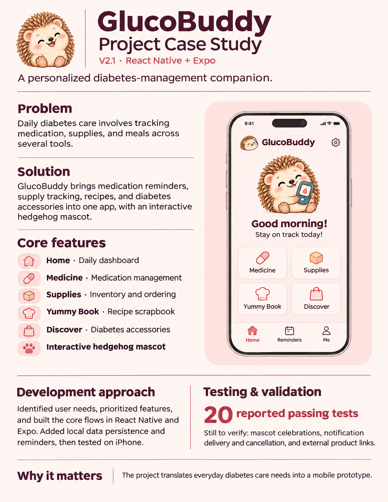

# GlucoBuddy




GlucoBuddy is a diabetes care companion prototype designed to make everyday routines easier to organize. From the home dashboard, users can see which medications they’ve marked as taken and which supplies are running low. They can set daily medication reminders, log or undo dose entries, review their dose history, and track supplies such as sensors, test strips, and needles. Stock estimates based on typical daily use help users plan when to reorder, and they can mark orders as placed or received.

The app also includes Yummy Book, a recipe scrapbook with optional carbohydrate notes, and Discover, a wishlist for diabetes accessories. A hedgehog mascot changes poses across screens and celebrates when the day’s medication checklist is complete.

The V2.1 mobile prototype is built with React Native and Expo and saves entries on the device. The repository also includes a browser-based prototype.


| Version | Source | Stack |
| --- | --- | --- |
| Web V2 | [web/](web/) | HTML, CSS, JavaScript, and browser localStorage |
| Mobile V2.1 | [mobile/](mobile/) | React Native and Expo |

## Mobile V2.1 features

| Feature | What you can do |
| --- | --- |
| Home dashboard | See how many of today's medications you've marked as taken and how many supplies are at or below their reorder buffer. Open the medication checklist or stock screen directly from the dashboard. |
| Medication checklist | Add a medication name, optional prescribed dose or notes, and a daily time in 24-hour format. Mark a dose as taken or tap again to undo the entry. |
| Dose history | Review timestamped “taken” and “undone” events alongside the scheduled time. Removing a medication from the checklist keeps its existing history. |
| Supply inventory | Track items such as sensors, strips, and needles. Enter the remaining quantity, typical daily use, and a reorder buffer in days. The app estimates days of stock and flags items that reach the buffer. |
| Reorder workflow | Adjust the remaining quantity one unit at a time. Mark an order as placed, undo that status, or mark it as received. Adjust the quantity manually when new stock arrives. |
| Local reminders | Schedule a daily medication reminder and a one-time supply check based on estimated stock and the reorder buffer. Notifications use Expo and depend on device permissions and settings. |
| Yummy Book | Save recipe names with optional carbohydrate notes for your portions. Review or remove entries from the recipe scrapbook. |
| Discover | Keep a wishlist of diabetes accessories, such as sensor covers. Add an optional HTTPS product link, open it from the wishlist, or remove the entry. |
| Hedgehog mascot | See different illustrations across screens. The Home mascot changes to a celebration pose when every medication on today's checklist is marked as taken. |
| Local storage | The mobile prototype uses AsyncStorage to retain medications, dose history, supplies, recipes, and wishlist entries across app restarts. |

## iPhone testing

The project case study records **20 reported passing manual checks**, including dashboard navigation, marking and undoing doses, history persistence after restart, and stock and order workflows. Mascot celebrations, notification delivery and cancellation, and opening external product links still need verification.


## Try the web prototype

From the repository root, run:

```sh
python3 -m http.server 8080 --directory web
```

Open [localhost:8080](http://localhost:8080). Try marking a sample medication as taken, exporting the event history as CSV, or updating a supply order status. Use fictional data for demos. Browser reminders depend on notification permissions and an open page.

## Mobile prototype

See the [Expo setup and testing notes](mobile/README.md) for the mobile draft.

## Project status

GlucoBuddy is a portfolio prototype for organizing daily routines. It uses local device storage and is intended for demonstration with fictional data.
